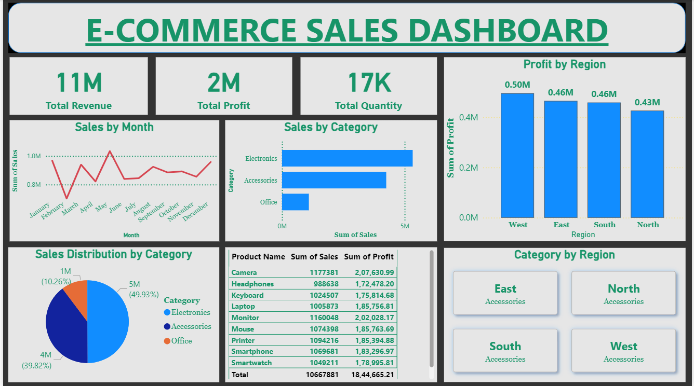
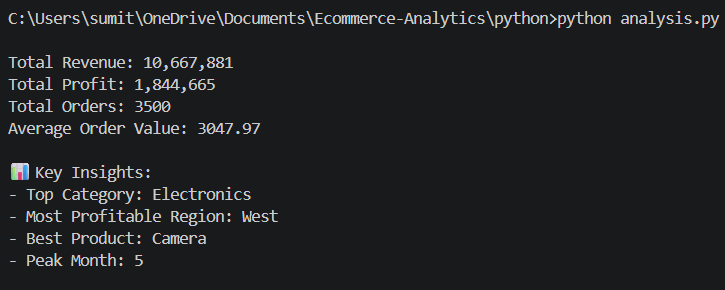
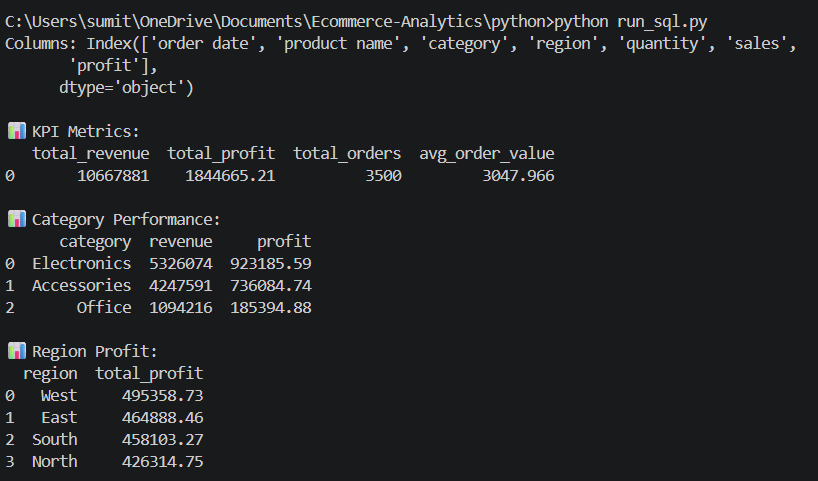

# E-Commerce Sales Analytics Platform

## 📌 Project Overview
An end-to-end data analytics project using Python for data cleaning, SQLite for relational querying, and Power BI for executive reporting to isolate regional profit leakage and optimize product performance metrics.

## 🛠️ Tools Used
* **Python Frameworks:** Pandas, NumPy, Matplotlib, Seaborn
* **Relational Database Management:** SQL / SQLite (Window Functions, Aggregate Joins, CTEs)
* **Business Intelligence Platform:** Power BI Desktop

## 📊 Key Analytical Insights
* **Product Performance:** The Electronics category generated the highest absolute performance baseline, contributing **$5,326,074 in revenue** and **$923,185.59 in profit**.
* **Geographical Distribution:** The West Region generated the highest absolute profit metrics (**$495,358.73**), driven by superior customer margin optimizations.
* **Core Efficiency Baseline:** The transactional log recorded an overall organizational **Profit Margin of 17.29%** across 3,500 total orders, driven heavily by top-performing products like Camera ($1,177,381 sales).

## 📈 Executive Dashboard Preview


👉 **[Click Here to Open and View the Complete Interactive PDF Report](./dashboard/E-Commerce_Sales_Dashboard_Report.pdf)**

## 💻 Python & SQL Automation Output



## 💾 Core SQL Query Portfolio

```sql
SELECT 
    product_id, 
    SUM(sales) AS total_revenue,
    ROUND((SUM(profit) / SUM(sales)) * 100, 2) AS profit_margin_pct
FROM sales_data
GROUP BY product_id
ORDER BY total_revenue DESC
LIMIT 10;
```
